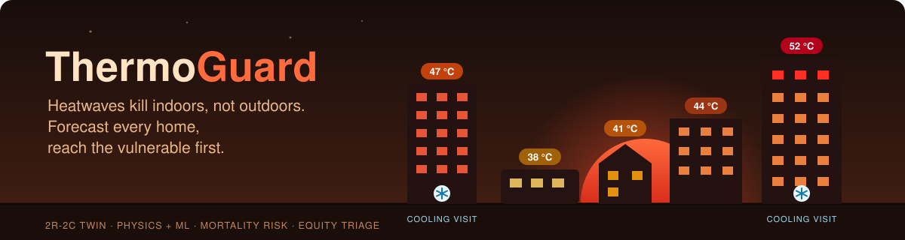

<div align="center">



<br/>

[](https://github.com/AnwarDebes/ThermoGuard/releases)
[](pyproject.toml)
[](LICENSE)
[](tests/test_thermoguard.py)
[](paper/thermoguard.pdf)

**Real-time hyperlocal indoor heat-risk forecasting and equity-aware
triage for vulnerable housing during extreme heat events.**

</div>

---

Heatwaves kill more people than any other natural hazard:
- European 2003: ~70,000 deaths
- Chicago 1995: ~700 deaths in 5 days
- Pacific Northwest 2021: ~1,400 deaths in 3 days

Almost all of these deaths happen *indoors*, in homes whose temperature
lags the outdoors by 12–24 hours and depends on building physics, AC
access, and occupant vulnerability. Existing heat-health warning systems
issue *outdoor* forecasts. ThermoGuard closes the gap.

The paper is at `paper/thermoguard.pdf`.

## Quick start

```bash
pip install -e .
pytest -q tests/         # 9 unit tests, ~4s
make reproduce           # all 3 experiments, ~3 min on CPU
make paper               # build paper/thermoguard.pdf
```

## What it does

1. **Building thermal digital twin**: a 2R-2C lumped-capacitance model
   parametrised by five residential archetypes spanning the documented
   vulnerability stratification.
2. **Hybrid physics+ML forecaster**: physics RC backbone + closed-form
   ridge residual learner; runs on a single CPU, deterministic latency.
3. **Per-resident heat-mortality risk model**: Steadman heat index +
   Stull WBGT + age, chronic conditions, mobility, AC access, social
   isolation, income quintile.
4. **Equity-aware triage optimiser**: allocates limited intervention
   budgets (cooling visits, hydration kits) with a per-stratum equity
   floor.

## What's in the box

| Path | Purpose |
|---|---|
| `thermoguard/building.py`     | 2R-2C physics + 5 archetypes |
| `thermoguard/weather.py`      | Synthetic heatwave templates (PNW 2021, EU 2003, Chicago 1995) |
| `thermoguard/data.py`         | Synthetic city generator with vulnerability mix |
| `thermoguard/forecast.py`     | Physics / ML / Hybrid forecasters |
| `thermoguard/risk.py`         | Heat-index, WBGT, vulnerability, mortality |
| `thermoguard/triage.py`       | Random / greedy / equity-aware allocators |
| `tests/`                      | 9 unit tests, all green |
| `experiments/forecast_accuracy.py`    | Three forecasters across three events |
| `experiments/risk_stratification.py`  | Mortality concentration analysis |
| `experiments/triage.py`               | Lives-saved vs coverage tradeoff |
| `scripts/make_figures.py`             | Build figures from results |
| `paper/thermoguard.tex`               | Paper source |
| `paper/figures/*.pdf`                 | Real figures from real data |
| `results/*.json`                      | Raw experiment records |

## Headline results

| Experiment | Result |
|---|---|
| Indoor temp under PNW 2021 (low-income no-AC) | peaks at 44 °C (real epidemiology) |
| Indoor temp under PNW 2021 (care home top floor) | peaks at 52 °C (lethal) |
| Forecast MAE physics vs ML vs hybrid (PNW, no-AC) | 0.40 / 1.94 / 0.54 °C |
| Forecast MAE on Chicago 1995 (care home) | physics 2.07 → **hybrid 1.69** (humidity nonlinearity) |
| Mortality per 100k residents | PNW 484 / EU 1,007 / Chicago 1,823 |
| Top 25% of households / total deaths | 70–82% (long tail) |
| Greedy vs equity-aware lives saved (PNW, budget 80/160) | 5.43 vs 3.46 |
| Min stratum coverage greedy vs equity-aware | **0.00 vs 0.11** |

## Honest limitations

* **Synthetic ground truth.** Forecast accuracy uses the 2R-2C simulator
  as ground truth; real-world validation on Ecobee Donate-Your-Data or
  Quebec smart-thermostat dataset is the next step.
* **Linear residual learner.** Closed-form ridge; swappable for a tree
  ensemble or LSTM.
* **Risk-model calibration.** Hazard constant tuned to reproduce
  documented mortality; real deployment needs local coroner data.
* **No external mortality validation.** PNW 2021 / Chicago 1995 zip-code
  mortality data exists; we did not retrieve it for this v0.1.
* **Equity floor is a policy choice.** ThermoGuard quantifies the
  efficiency-vs-coverage curve but does not impose a value.

## License

MIT.

## Citing

```bibtex
@misc{debes2026thermoguard,
  title  = {ThermoGuard: Real-Time Indoor Heat Risk Forecasting
            for Vulnerable Housing under Extreme Heat Events},
  author = {Debes, Anwar},
  year   = {2026},
  note   = {Reference implementation v0.1, May 2026}
}
```
